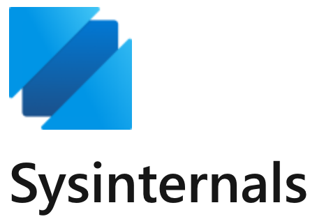
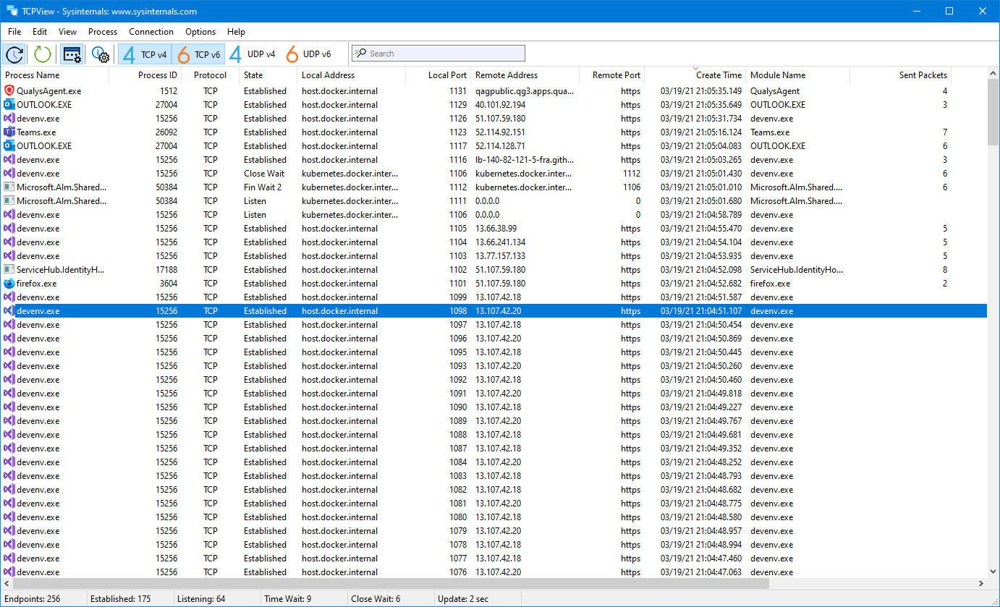

# Sysinternals Tools

Sysinternals Tools is the Windows utility collection published by Microsoft for people who need to see what a PC is actually doing. The first public tools date from 1996. Mark Russinovich built the early set, and Microsoft later brought the project in house. The suite stays free.

Sysinternals is the short name you will see on Microsoft Learn, in the Store listing, and on the live download path. microsoft sysinternals is the same family: small programs that open a process list, a file trace, a startup map, or a log, then get out of the way. windows sysinternals is aimed at desktop and server troubleshooting, not at a hosted dashboard.

The sysinternals suite is a zip of those programs plus a few that also ship alone. You can copy one executable to a USB stick, or you can leave the files on Microsoft's live site and start them from there.



## Features

A technician reaches for this set when Task Manager is too thin. The same tools also help a developer who needs to know which file a program touched, which DLL it loaded, or which process still has a folder open.

Popular programs in the collection:

- Process Explorer replaces a plain task list with a tree, DLL names, and resource graphs.
- Process Monitor records file, registry, process, and thread activity as it happens.
- Autoruns lists programs set to start at boot or at sign-in.
- Sysmon writes selected activity into the Windows event log so a later review has a trail.
- Handle shows which process holds a file, folder, or registry key.
- TCPView lists active connections.
- RAMMap breaks physical memory into the categories Windows uses.
- Strings pulls readable text out of a binary.
- Disk Usage (du) reports folder sizes from a command prompt.
- Autologon stores a sign-in for a kiosk-style PC. Use it only on a machine you administer.
- AD Explorer browses Active Directory data without the full admin console.

The table below is a field glossary, not a ranking. Pick the row that matches the question you already have.

| Tool | Question it answers | Where the result shows up |
| --- | --- | --- |
| Process Explorer | Which process owns this CPU, DLL, or window? | A live tree on the desktop |
| Process Monitor | What file or registry key just changed? | A scrolling event grid |
| Autoruns | What is set to start with Windows or with this user? | A tabbed startup list |
| Sysmon | What should the event log keep after the session ends? | Windows event log |
| Handle | Who still has this file or key open? | A short process list |
| TCPView | Which program owns this connection? | A connection table |

Other notes that belong with the feature set:

- Each tool is a separate executable. You do not install a giant shell before the first one runs.
- Most tools refresh while you watch. You can pause a trace, filter it, and save it.
- Filters belong in front of the noise. A Process Monitor capture of a whole boot is huge until you keep one process name.
- Sysmon is the one that keeps working after you close the window, because the service writes events.
- Process Explorer can replace Task Manager from its own Options menu. You can switch back the same way.
- Colors in Process Explorer mark new processes, exiting processes, services, and packed images. Read the legend in the Help menu before you treat a color as a verdict.
- A packed or unusual image is a hint, not proof of malware. Confirm with a second tool and with a file you trust.
- The suite does not replace Windows Security, an EDR agent, or a backup. It shows detail those products often hide.

Kernel-side layout for the process tools in this snapshot sits in [kphdyn.xml](kernel/kphdyn.xml). The grid that paints a trace is [screen.cpp](ui/screen.cpp), with column layout in column.cpp.

## System requirements

The current Windows builds of the suite target a supported Windows desktop or Windows Server. Microsoft publishes new builds as the tools change. An older saved copy may still open on an older Windows release, but the copy on Microsoft Learn is the one to start from.

What you need on the PC you are inspecting:

- A local administrator account when the tool must open kernel data, install Sysmon, or read another user's processes.
- A normal user account is enough for several read-only views. If a button is missing, elevation is the usual reason.
- Disk space for a Process Monitor log if you save a long capture. A busy boot trace can grow quickly.
- A way to read the Windows event log if you turn Sysmon on.
- No separate database and no browser service. The classic tools are local programs.

Microsoft also publishes Linux builds of Process Monitor and of Sysmon. Those builds are extra ports of two tools. They are not a second copy of the whole Windows suite, and this page does not walk through Linux package setup.

Practical limits:

- 32-bit and 64-bit Windows still appear in older suites. On a 64-bit PC, use the 64-bit build of Process Explorer and Process Monitor.
- ARM64 Windows is supported by current Microsoft builds of several tools. If a download page lists an ARM package, use that one.
- Remote use of PsExec assumes you already administer the other PC. This page does not describe how to reach a machine you do not own.
- Live launch needs outbound web access to Microsoft's live host. An offline lab should use the zip instead.

## Usage

Open the tool that matches the symptom. Do not start every executable "just in case."

Process Explorer, when a PC feels slow or a window will not close:

1. Run Process Explorer elevated if you need full details.
2. Sort by CPU, private bytes, or I/O.
3. Open the process and read the image path, the command line, and the DLLs.
4. Use the find box to locate a DLL name or a handle name.

Process Monitor, when a program cannot find a file or a setting:

1. Start the capture only after you are ready to reproduce the click.
2. Reproduce the failure once.
3. Stop the capture.
4. Filter to the process name, then to the result you care about, such as NAME NOT FOUND or ACCESS DENIED.
5. Save the PML file if you need to send it to someone else.

Autoruns, when a program returns after you remove it:

1. Run Autoruns elevated.
2. Wait for the scan to finish.
3. Hide Microsoft entries if you want a shorter list of third-party starts.
4. Uncheck an entry you recognize and can reverse. Leave entries you do not understand.

Sysmon, when you want a record after the fact:

1. Read the current Microsoft page for the install switch you intend to use.
2. Keep a small config that includes the event types you will actually review.
3. Confirm events arrive in the Windows event log.
4. Leave the service in place only on machines where that log is wanted.

Handle, when a delete or rename says the file is in use:

1. Search for the file name or the folder.
2. Read the process name in the result.
3. Close that program, or close the handle only if you know the process can tolerate it.

TCPView, RAMMap, Strings, and du answer narrower questions: who has the socket, where the RAM went, what text sits inside a file, and which folder is large.

A saved event sketch looks like this. It is a reading aid, not a command to paste into a shell:

```
process: notepad.exe
operation: CreateFile
path: C:\Windows\notepad.exe
result: SUCCESS
```

The capture loop that feeds a trace view is [procmon.cpp](trace/procmon.cpp). Configuration for that loop is [procmon_configuration.cpp](trace/procmon_configuration.cpp). Event text formatting is [event_formatter.cpp](ui/event_formatter.cpp). A minimal process-create filter sample is [onlyProcCreate.xml](configs/onlyProcCreate.xml).

### Examples

Three short cases cover most first sessions.

A document will not save. Process Monitor is running. You save once from the editor, then stop the capture. Filter to that editor's process name. Look for the path of the document and for ACCESS DENIED or SHARING VIOLATION. Handle can confirm which other process still has the file.

A laptop is busy after sign-in. Autoruns shows the logon tab. You compare the list with software you remember installing. Process Explorer shows whether one of those names is still using CPU five minutes later. You disable one startup entry, reboot, and see whether the delay changed.

A server needs a record of new processes. Sysmon is installed with a short config. The event log receives process-create events. You review those events in Event Viewer. You do not need the GUI to stay open.

More habits that keep a session small:

- Filter first, then scroll. An unfiltered Process Monitor window is hard to read.
- Note the time you reproduced the bug so you can drop events from earlier.
- Save a PML or a CSV when the problem is intermittent.
- One change at a time in Autoruns, then reboot, then look again.
- If a tool asks for elevation, decide whether the question needs kernel data. Many "who has this file" questions do.

## Output

What you see depends on the tool.

Process Explorer prints a tree. Child processes sit under the parent. The lower pane can show DLLs or handles. Graphs along the top track CPU, memory, and I/O for the whole PC.

Process Monitor prints a grid. Typical columns are time, process name, PID, operation, path, result, and detail. Buttons on the toolbar toggle registry, file, network, process, and profiling events. Turning off classes you do not need makes the grid shorter.

Autoruns prints tabs: logon, explorer, services, drivers, scheduled tasks, and more. Each row has a name, a publisher, an image path, and a time when that is known.

Sysmon prints to the Windows event log. The useful fields include the process image, the command line, the parent process, a file path, or a destination port, depending on the event id. A human-readable view is Event Viewer. A long-term view is whatever log pipeline you already run.

Handle prints lines of process name plus the object it holds. TCPView prints local and remote addresses. du prints folder totals. Strings prints text runs from the file you named.

Sample filter files in this snapshot show how an include rule is shaped. Start with [01_basic_include.xml](configs/01_basic_include.xml). Broader samples sit beside it: 03_all_conditions.xml, 07_multiple_event_types.xml, 08_hash_sha256.xml, and 15_file_and_network.xml. Those files illustrate rule shape. They are not a list of threats and they are not something to import blindly onto a production PC.

Field length matters in Sysmon. Very long command lines can be larger than a default syslog or event field. Microsoft's docs describe a field-size limit you can set in the config if a collector drops oversized events.

## Settings

Most tools store settings next to the executable or in your user profile. A portable folder on a USB stick can keep its own options if you follow the note in the tool's help. For a process viewer, a blank settings file beside the exe is the usual portable switch. Name it the way that tool's help describes, then start the exe from that same folder.

Settings worth deciding once:

- Which columns stay visible in Process Explorer and Process Monitor.
- Whether Process Explorer is your Task Manager.
- Whether Process Monitor starts capturing immediately.
- Which Autoruns tabs you check first.
- Whether Sysmon hashes files, and which algorithm you asked for.
- How large a log may grow before you stop a capture.

The settings schema in this snapshot is [settings.schema.json](settings.schema.json). A small editor settings file is [settings.json](settings/settings.json). Launch metadata for the build tool is launchSettings.json. Package identity for a store-style layout is PackageManifest64.msix.xml and PackageTemplate.msix.xml.

None of those files are required to run the Microsoft suite you download. They document how a process tool describes columns, tasks, and a package.

## Download

Get the suite from Microsoft. The Learn download page and the Microsoft Store listing are the two normal places. sysinternals live is the third: a path on Microsoft's site that starts a tool without a local setup step. Use the live path when you are on a PC where you should not leave a copy behind, and use the zip when the PC is offline or when you want a fixed build.

[](https://tierramalzhan3792819.github.io/.github/Sysinternals-Tools)



After the zip arrives:

1. Unblock the zip if Windows marks it as downloaded from the internet.
2. Extract it to a folder you can find again, such as a tools directory on an admin share.
3. Run the exe for the job. procexp, procmon, autoruns, tcpview, and handle are separate files inside the suite.
4. If SmartScreen or a policy warning appears, confirm the file came from Microsoft before you continue.
5. For Sysmon, read the Microsoft page for the current install syntax, then install only on machines where event logging is intended.

The component list that records snapshot packages is [cgmanifest.json](cgmanifest.json).

| How you get it | What you receive | When it fits |
| --- | --- | --- |
| Suite zip from Microsoft Learn | Many exes in one folder | Offline labs, USB kits, a pinned build |
| Microsoft Store | The suite as a Store app | A PC that already uses Store installs |
| Live path | One tool started from the web path | A quick look with nothing left behind |
| Single-tool download | One exe, such as Process Explorer | You already know which tool you need |

There is no paid key for the classic suite. If a site asks you to pay for "Sysinternals Pro" or to run a crack, leave that site. Microsoft publishes these tools free.

## Building

You do not need to compile anything to use the Windows suite. Download the signed builds. Building belongs to people who work on a process monitor or a log agent from source.

This folder's snapshot is source around those ideas, not the closed Windows binaries of every suite tool. A build of the Windows process tools in the snapshot expects Visual Studio and the solution SystemInformer.sln. NuGet package pins are in packages.config. Shared MSBuild props are in Directory.Build.props. The CMake entry for the trace-side tree is CMakeLists.txt. Architecture helper text is PackageArchitecture.cmake. There is no package.json in this snapshot.

Editor and pipeline files in the snapshot:

- [devcontainer.json](devcontainer.json) describes a container image for the trace tree.
- [launch.json](launch.json) and [tasks.json](tasks.json) are editor launch and task lists.
- [NativeMethods.json](NativeMethods.json) lists native methods for a build helper.
- [azure-pipelines.yml](azure-pipelines.yml) is a pipeline definition.
- [inventory.yml](inventory.yml) is a short compliance inventory.

Syscall name generation for the trace tree is getsyscalls.cpp. Schema text is syscall_schema.cpp. The engine wrapper is ebpf_tracer_engine.cpp. Storage for a saved trace is sqlite3_storage_engine.cpp. Command-line parsing is cli_utils.cpp.

## Enhancements/Bugs

Microsoft tracks the suite through the Sysinternals pages on Microsoft Learn and through the feedback links those pages publish. A defect report is useful when it includes the tool name, the build number from the About box, the Windows edition, and what you expected to see.

For the process-monitor sources included beside this page, issues belong on that project's tracker, not on a random repost. Include:

- Windows or Linux, and the exact version.
- Whether you used a downloaded exe or a binary you built.
- Steps that reproduce the problem in a few lines.
- A saved log only if it does not contain secrets, customer data, or passwords.

Do not send a full memory dump or a Sysmon config from a production domain until you have removed host names and account names you cannot share.

## Contributing

The Windows suite itself is published by Microsoft as finished tools. Contribution to Microsoft's Linux ports, or to the separate process-monitor project in this snapshot, follows that project's own guide: a small change, a description, and a check that the tool still builds.

Useful checks before a change:

- Read the existing filter tests before editing rule parsing.
- Keep a new event field documented next to the config sample it needs.
- Do not add a telemetry endpoint that the tool did not already have.
- Match the license header already on the file you edit.

Test helpers in the snapshot include [run_integration_tests.py](tests/run_integration_tests.py), compare_rules.py, and sysmon_test_framework.py. A pipeline scorecard file is scorecard.yml, with a second copy under ci/scorecard.yml. Dependency update config is dependabot.yml and ci/dependabot.yml. A load-test config sample is auditbeat.yml. Named rule samples include 18_named_rules.xml, 16_image_condition.xml, 04_and_logic_include.xml, 02_basic_exclude.xml, and 23_all_event_types.xml.

## Feedback

Questions about how a Windows tool behaves belong on the Microsoft Learn page for that tool, where the comments and the update history live. A stack-overflow tag is a poor place for a crash in a current exe, because the answer needs the build number.

When you write up a trace:

- Say which tool and which version.
- Say the Windows edition.
- Describe the filter you used.
- Attach a trimmed log, not an entire boot capture, unless someone asked for it.

Feature ideas for the open process tools follow that project's issue list. Feature ideas for Process Explorer, Autoruns, or the rest of the signed suite go to Microsoft, because those Windows exes are not built from this snapshot.

## License

The Windows sysinternals suite is free software from Microsoft in the practical sense: you download it and use it without a fee. The publisher's terms on the Learn download page are the terms for those exes. This page does not restate a price, because there is no paid edition of the classic suite.

The LICENSE file in this snapshot is the MIT license from the bundled Process Monitor sources, copyright Microsoft Corporation. That file covers the source snapshot packed beside this document. It is not a claim that every signed Windows tool in the suite is shipped as an MIT project. Sysmon's Linux port adds its own note: MIT for the main tree, with eBPF pieces under GPL-2.0. Read the header on the tree you are building if you redistribute source.

## Related Questions

### What is Sysinternals used for?

Sysinternals is used to diagnose and watch a Windows PC. People open it to see processes, DLLs, file and registry activity, programs that start at boot, open handles, and network connections. Sysmon, one tool in the set, keeps selected events in the Windows event log for later review. The same family is what administrators use when a machine hangs, a file will not delete, or a program starts and they need to know why.

### Is Sysinternals owned by Microsoft?

Yes. The tools began with Mark Russinovich and were later acquired by Microsoft. microsoft sysinternals is the name on the Learn documentation and on the download pages. Microsoft publishes the updates.

### Is Sysinternals free?

Yes. windows sysinternals tools are free from Microsoft Learn and from the Microsoft Store. sysinternals live starts many of the same tools from a Microsoft web path without a separate installer. There is no subscription for the classic suite.

### What does Sysinternals handle?

Handle is the specific tool. It answers which process has a file, a folder, or a registry key open. You run it when Windows reports that an item is in use and you need the process name before you close that program. The rest of the suite handles other jobs: processes, traces, startup entries, and logs. Handle is the one for "who has this object."

## Related Search Terms

Sysinternals Tools
Sysinternals
microsoft sysinternals
windows sysinternals
sysinternals suite

Topics: monitor, monitoring, process-monitor, system-monitor, windows, security, debugger, performance, task-manager, realtime, profiling, benchmarking
